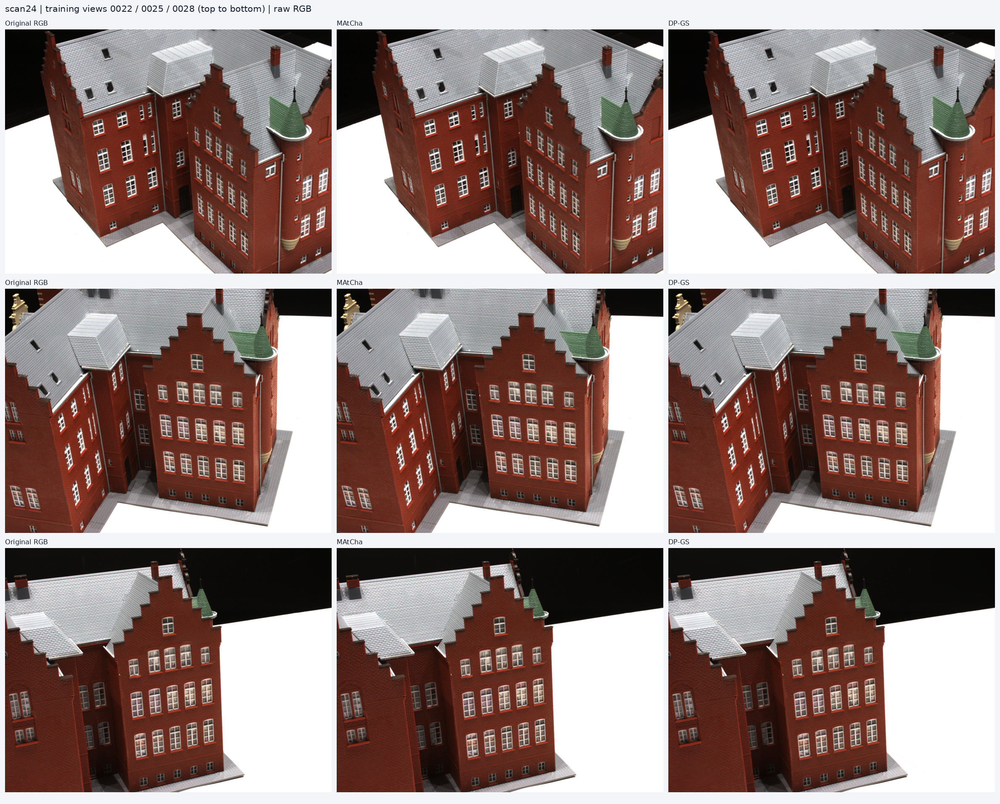
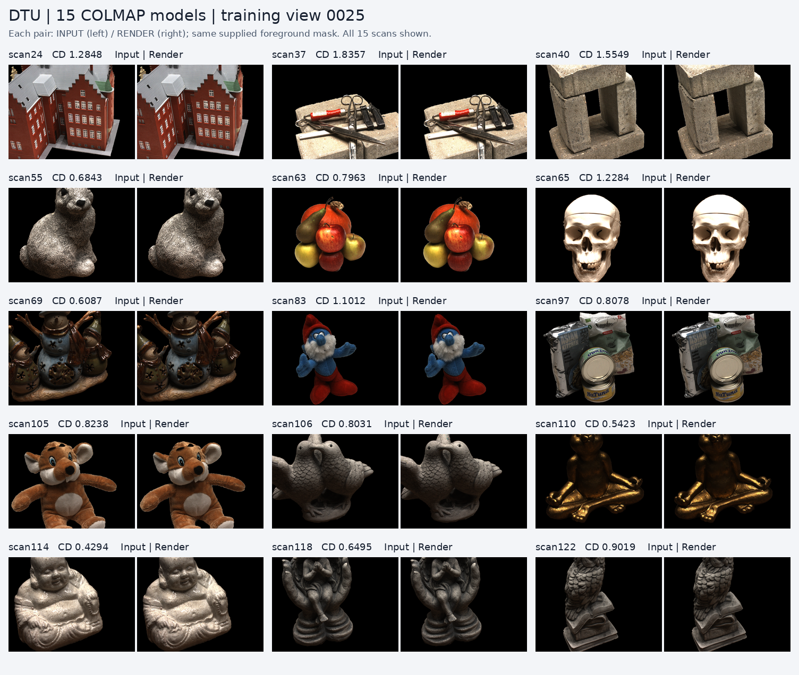
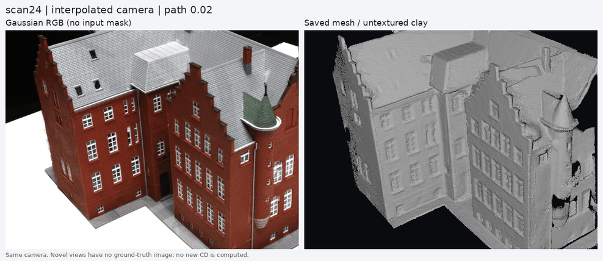

# DP-GS 与 MAtCha：DTU COLMAP 复现与结果

基于 [hanl2010/DP-GS](https://github.com/hanl2010/DP-GS)，源码基准提交 `dc1ce835ea3c6bb7887333c50df7a13497a45c09`。保留上游许可证及第三方源码，原项目说明见 [UPSTREAM_README.md](UPSTREAM_README.md)。

## 原图、MAtCha、DP-GS 并排对比

已完成全部 15 个 DTU 场景。每行从左到右为 **原图、MAtCha、DP-GS**，从上到下为 **0022、0025、0028** 三张训练视角；主图使用完整 RGB，不加前景遮罩。



**[查看全部 15 组并排对比图、逐场景 CD 与视频](output/MAtCha_comparison/README.md)** · [对比 CSV](output/dtu_matcha_vs_dpgs.csv) · [配置与验收说明](repro/MATCHA.md)

| 方法 | 平均 CD ↓（mm，15/15） |
|---|---:|
| MAtCha 当前 COLMAP 适配版 | 2.764451 |
| DP-GS | **0.936806** |

两种方法使用同一份 COLMAP 点云、相机和三张输入 RGB。MAtCha 使用本地 COLMAP 适配入口，图表对齐 1000 步、细化 7000 步；DP-GS 训练 10000 步。以上结果对应记录的配置，不声称精确复现论文中的 MAtCha 表格分数。训练视角的拟合图与新视角效果分开展示；插值新视角无对应实拍原图。

## 本次实验

- DTU `small_overlap`，全部 15 个 scan，COLMAP 初始化，每场景 10,000 次训练。
- RTX 4080 SUPER（实机报告 32,760 MiB），单卡串行，Python 3.10.20 / PyTorch 2.4.1+cu124 / CUDA toolkit 12.4，使用 uv。
- 15/15 场景的 Gaussian 全浮点属性、非空网格及官方 CD 通过验收。
- **平均 CD：0.936806**；用户提供论文表格中 Ours 对应均值为 1.02。这是本次实测结果，不代表方法改进或逐项重现论文数字。
- MASt3R 训练、large_overlap 和 TNT 不在本次完成范围内。

[逐场景完整结果](repro/RESULTS.md) · [CD CSV](output/dtu_colmap_sfm_small_overlap.csv) · [验收与模型路径清单](repro/records/dtu_colmap_completion.json)

## 图像与三维结构展示

训练视角对比：每组左侧原图、右侧模型渲染，均使用相同原图前景遮罩。训练图像拟合很接近，不能据此声称新视角效果。



移动插值视角：左侧实际 Gaussian RGB 渲染，右侧已提取网格的纯灰材质。没有重新训练、修改几何或使用原图前景遮罩；两侧相机投影经过数值核对。视频在训练相机覆盖范围内往返，不包含原训练相机的完整位姿；没有新视角真实图像，不能进行新视角定量评估。



- [scan24 高清 MP4](output/DTU_geometry/colmap_sfm_small_overlap/scan24/rgb_mesh_motion.mp4)
- [训练视角展示页](output/DTU_visuals/colmap_sfm_small_overlap/index.html)：15 个模型 × 3 个视角，RGB、深度与法线。
- [移动视角与网格展示页](output/DTU_geometry/colmap_sfm_small_overlap/index.html)：15 段视频及三视角静态图。

HTML 展示页可在克隆后用浏览器打开；GitHub 仓库网页通常显示 HTML 源码，PNG/GIF/MP4 可直接查看或下载。

## 上传内容与保留在服务器的内容

按本次要求，上传源码、uv 配置与锁文件、评估指标、图像、视频、配置和训练日志。原 `output`、`logs` 在服务器上是持久盘符号链接；这里上传的是筛选后的实际文件，不是服务器绝对路径链接。

**不上传**数据集、下载的预训练权重、Gaussian 训练权重、外观权重、网格和误差点云（PLY）、原始 NPY/NPZ 数组、虚拟环境及编译缓存。模型路径和部分清单中的绝对路径是原服务器的实验记录；这些被排除的文件仍保存在服务器。可视化清单提及的原始数组也只保存在服务器。

训练标量和部分原始训练视角图像保留在 TensorBoard 事件文件中；运行日志在 [logs](logs)，实验与图像位姿清单在 [repro/records](repro/records)。

## 复现

完整安装、数据准备及分阶段入口见 [repro/README.md](repro/README.md)。下面的训练/重新渲染命令需要自行准备数据和权重，仓库展示文件可直接浏览。

```bash
# Linux GPU 服务器，需要 CUDA 12.4 toolkit、编译工具和 uv。
source repro/env.sh
bash repro/setup_uv.sh

# 数据和预训练权重准备好后：只跑已限定的 COLMAP 15 场景。
bash repro/run_all_dtu.sh

# 已有本机训练模型时补充图像与三维结构展示。
python repro/render_dtu_visuals.py
python repro/render_dtu_geometry.py
```

`repro/env.sh` 针对此次服务器（CUDA 12.4、SM 8.9）；其他 GPU 需按设备修改环境参数。不要用单独的 `uv sync` 覆盖完整环境而漏装本地 CUDA 扩展；安装脚本会在锁定依赖后补装它们。

## 数值问题与验证

scan83 初次运行的总损失出现 NaN，最终模型存在非有限参数，整个失败运行已在服务器归档，未计入 CD。增加空二值传播 mask 的零支持保护，以及非有限总损失立即报错；非空 mask 的损失和梯度保持原值，CPU/CUDA float32/float64 回归检查通过。scan83 按原配置重跑后通过完整验收，且空 mask 保护在重跑中实际触发。未按 CD 高低挑选重跑。

前 7 组的全部 10,000 步总损失均有限，重新验收后保留。数值修复、验证与失败原件的路径记录见 [RESULTS.md](repro/RESULTS.md) 和 [repro/records](repro/records)。TNT 评估器的自测仅证明工具兼容性，不是 TNT 实验成绩。
